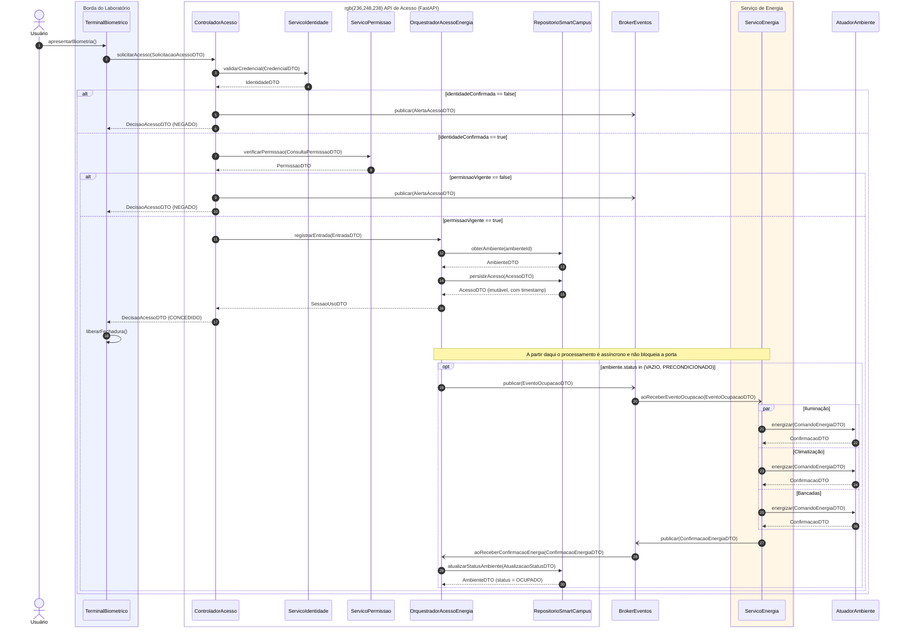
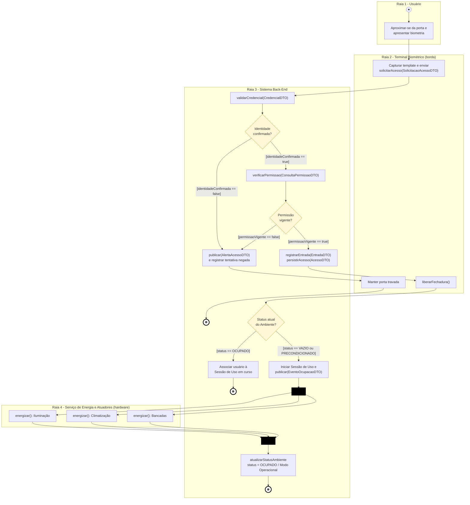
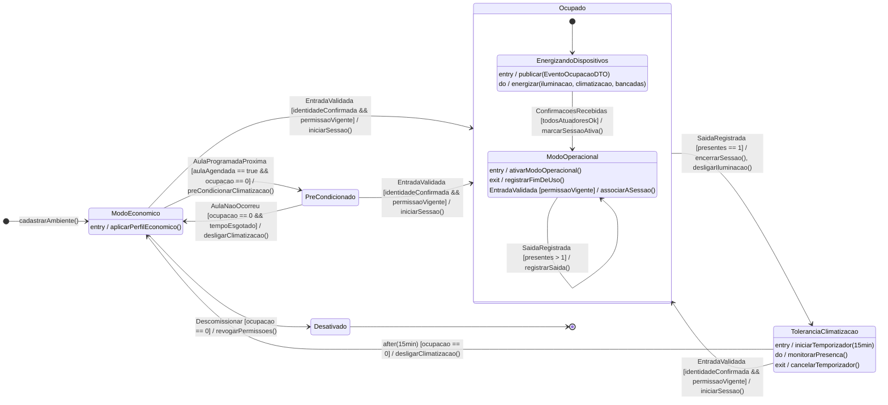
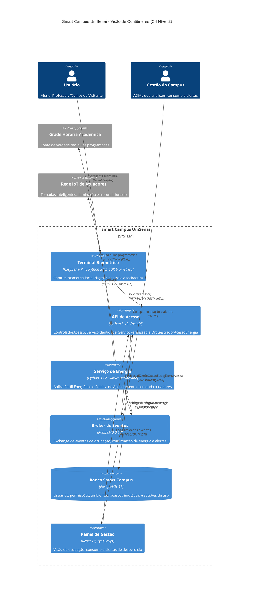
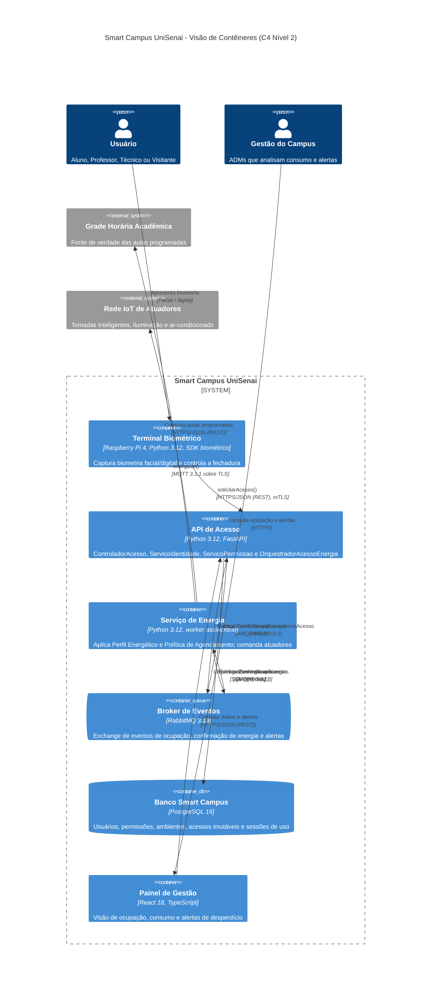

# APS 3 — Dossiê de Arquitetura Viva: Acesso Biométrico e Energização do Laboratório

**Unidade Curricular:** Modelagem de Software — Engenharia de Software (4º período, UniSenai)
**Docente:** Prof. Sidney
**Projeto da equipe:** Smart Campus UniSenai (Sprint 1 — Modelo 7)
**Autor:** Nicolas de Freitas Machado

## 1. Funcionalidade crítica escolhida

**Acesso biométrico com abertura de Sessão de Uso e energização paralela do laboratório.**

Quando uma pessoa apresenta a biometria na porta de um laboratório, o sistema precisa decidir, na mesma operação, (a) se ela pode entrar e (b) se a energia do ambiente deve ser ativada. Essa é a "causa raiz" de todo o comportamento do domínio descrito na Sprint 1 (seção 10.2): identidade e autorização disparam a Sessão de Uso, que aciona o Perfil Energético, que comanda os atuadores.

**Por que é crítica**

- **Segurança:** o laboratório tem equipamentos sensíveis; identidade válida sem permissão vigente deve resultar em acesso negado (Sprint 1, 3.1 e 3.5).
- **Energia:** a energização só pode decorrer de uma Sessão de Uso legítima ou de agendamento (Sprint 1, 3.7 e 7).
- **Auditoria:** cada `Acesso` é um registro imutável com carimbo de data/hora.
- **Concorrência:** iluminação, climatização e bancadas são energizadas em paralelo, e a porta não pode esperar por elas.

**Escopo coberto nos fluxos da Sprint 1:** 5.1 (entrada em ambiente vazio), 5.2 (usuário adicional), 5.3 e 5.4 (saídas, no diagrama de estados), 5.5 (acesso negado) e 5.6 (pré-condicionamento, no diagrama de estados).

## 2. Estrutura do repositório

```
aps3-nome-sobrenome/
├── docs/
│   ├── architecture/
│   │   ├── workspace.dsl        # C4 em Structurizr DSL (níveis 2 e 3)
│   │   └── adr-0001.md          # Registro de Decisão Arquitetural
│   └── diagrams/
│       ├── sequencia.mmd        # Artefato 1
│       ├── atividades.mmd       # Artefato 2
│       ├── estados.mmd          # Artefato 3
│       ├── c4-containers.mmd    # Artefato 4 (Mermaid C4, igual ao workspace.dsl nível 2)
│       └── img/                 # PNGs renderizados com mmdc (Mermaid CLI)
└── README.md
```

O C4 foi entregue em **duas notações equivalentes**: `workspace.dsl` (Structurizr DSL, conforme a estrutura de pastas da folha) e `c4-containers.mmd` (Mermaid, conforme o Artefato 4). Os dois descrevem os mesmos contêineres, tecnologias e protocolos.

## 3. Artefato 1 — Diagrama de Sequência

Notação: `->>` chamada síncrona bloqueante, `-)` mensagem assíncrona (mensageria), `-->>` retorno com DTO. Fragmentos usados: `alt/else` (dois níveis, tratamento de acesso negado), `opt` (só inicia energização se o Ambiente estava vazio/pré-condicionado) e `par` (energização paralela).




### 3.1 Regra de consistência: mensagem → operação pública da linha de vida destino

| Linha de vida (destino) | Operações públicas | Mensagens recebidas no diagrama |
|---|---|---|
| `TerminalBiometrico` | `apresentarBiometria()`, `liberarFechadura()` | `apresentarBiometria()`, `liberarFechadura()` (auto-mensagem) |
| `ControladorAcesso` | `solicitarAcesso(SolicitacaoAcessoDTO): DecisaoAcessoDTO` | `solicitarAcesso(SolicitacaoAcessoDTO)` |
| `ServicoIdentidade` | `validarCredencial(CredencialDTO): IdentidadeDTO` | `validarCredencial(CredencialDTO)` |
| `ServicoPermissao` | `verificarPermissao(ConsultaPermissaoDTO): PermissaoDTO` | `verificarPermissao(ConsultaPermissaoDTO)` |
| `OrquestradorAcessoEnergia` | `registrarEntrada(EntradaDTO): SessaoUsoDTO`, `aoReceberConfirmacaoEnergia(ConfirmacaoEnergiaDTO)` | `registrarEntrada(EntradaDTO)`, `aoReceberConfirmacaoEnergia(ConfirmacaoEnergiaDTO)` |
| `RepositorioSmartCampus` | `obterAmbiente(ambienteId): AmbienteDTO`, `persistirAcesso(AcessoDTO): AcessoDTO`, `atualizarStatusAmbiente(AtualizacaoStatusDTO): AmbienteDTO` | as três chamadas correspondentes |
| `BrokerEventos` | `publicar(EventoOcupacaoDTO \| ConfirmacaoEnergiaDTO \| AlertaAcessoDTO)` | `publicar(...)` nos três formatos |
| `ServicoEnergia` | `aoReceberEventoOcupacao(EventoOcupacaoDTO)` | `aoReceberEventoOcupacao(EventoOcupacaoDTO)` |
| `AtuadorAmbiente` | `energizar(ComandoEnergiaDTO): ConfirmacaoDTO` | `energizar(ComandoEnergiaDTO)` (3 vezes, em `par`) |

### 3.2 DTOs

| DTO | Campos principais |
|---|---|
| `SolicitacaoAcessoDTO` | `ambienteId`, `templateBiometrico`, `instante` |
| `CredencialDTO` | `templateBiometrico`, `tipo` (FACIAL \| DIGITAL) |
| `IdentidadeDTO` | `identidadeConfirmada`, `usuarioId`, `papel` |
| `ConsultaPermissaoDTO` | `usuarioId`, `ambienteId`, `instante` |
| `PermissaoDTO` | `permissaoVigente`, `janelaInicio`, `janelaFim` |
| `EntradaDTO` | `usuarioId`, `ambienteId`, `instante` |
| `AcessoDTO` | `acessoId`, `usuarioId`, `ambienteId`, `tipo` (ENTRADA \| SAIDA), `timestamp` (imutável) |
| `AmbienteDTO` | `ambienteId`, `status` (VAZIO \| PRECONDICIONADO \| OCUPADO), `presentes` |
| `SessaoUsoDTO` | `sessaoId`, `ambienteId`, `iniciadaEm`, `novaSessao` |
| `DecisaoAcessoDTO` | `resultado` (CONCEDIDO \| NEGADO), `motivo` |
| `AlertaAcessoDTO` | `ambienteId`, `motivo` (IDENTIDADE_NAO_CONFIRMADA \| SEM_PERMISSAO), `instante` |
| `EventoOcupacaoDTO` | `idEvento`, `ambienteId`, `statusNovo`, `sessaoId`, `instante` |
| `ComandoEnergiaDTO` | `ambienteId`, `dispositivo` (ILUMINACAO \| CLIMATIZACAO \| BANCADAS), `acao` |
| `ConfirmacaoDTO` | `dispositivo`, `sucesso` |
| `ConfirmacaoEnergiaDTO` | `idEvento`, `ambienteId`, `todosAtuadoresOk` |
| `AtualizacaoStatusDTO` | `ambienteId`, `statusNovo` |

## 4. Artefato 2 — Diagrama de Atividades com Raias

Quatro raias: Usuário, Terminal Biométrico, Sistema Back-End e Serviço de Energia/Atuadores. As guardas de cada decisão são mutuamente exclusivas. A barra de **fork** divide a energização em três ramos paralelos (iluminação, climatização, bancadas) e a barra de **join** sincroniza as confirmações antes de marcar o Ambiente como `OCUPADO`. O Mermaid não tem elemento nativo de barra nem de raia: as raias são `subgraph` e as barras são nós pretos (`fork1`, `join1`).




## 5. Artefato 3 — Diagrama de Transição de Estados (entidade `Ambiente`)

Estados: `ModoEconomico` (inicial), `PreCondicionado`, `Ocupado` (subestados `EnergizandoDispositivos` e `ModoOperacional`), `ToleranciaClimatizacao` e `Desativado` (terminal). As transições usam a forma `Gatilho [Guarda] / Ação()`. Ações internas `entry /`, `do /` e `exit /` aparecem em `EnergizandoDispositivos`, `ModoOperacional` e `ToleranciaClimatizacao`. A entrada de um usuário adicional em `ModoOperacional` é uma transição interna (UML) mostrada no compartimento do estado.




**Proteção contra estados inválidos**

- `Ocupado` só é alcançado por `EntradaValidada [identidadeConfirmada && permissaoVigente]`; identidade sem permissão nunca muda o estado (Sprint 1, seção 7).
- `Ocupado` → `ToleranciaClimatizacao` só ocorre com `presentes == 1` na saída, ou seja, o último usuário; saídas com `presentes > 1` não encerram a sessão.
- `Desativado` só é alcançável de `ModoEconomico` com `ocupacao == 0`.
- A iluminação é desligada imediatamente na saída do último usuário e a climatização só após `after(15min)`, como definido no Perfil Energético.

## 6. Artefato 4 — Visão Arquitetural C4 (Nível 2, Contêineres)

Tecnologias e protocolos explícitos nos conectores: REST/HTTPS com mTLS, AMQP 0-9-1 (RabbitMQ 3.13), SQL (PostgreSQL 16) e MQTT 3.1.1 sobre TLS. O nível 3 (componentes da API de Acesso, que correspondem às linhas de vida do diagrama de sequência) está em `docs/architecture/workspace.dsl`.





## 7. Artefato 5 — ADR 0001

Ver [`docs/architecture/adr-0001.md`](docs/architecture/adr-0001.md): **mensageria assíncrona orientada a eventos (RabbitMQ)** para desacoplar a decisão de acesso da energização do ambiente. Status: Proposto.

## 8. Consistência entre os modelos

| Elemento | Sequência | Atividades | Estados | C4 / ADR |
|---|---|---|---|---|
| Validar identidade | `validarCredencial` | `validarCredencial(CredencialDTO)` | guarda `identidadeConfirmada` | `ServicoIdentidade` |
| Verificar permissão | `verificarPermissao` | `verificarPermissao(...)` | guarda `permissaoVigente` | `ServicoPermissao` |
| Registrar entrada e iniciar sessão | `registrarEntrada` | `registrarEntrada`, `persistirAcesso` | `iniciarSessao()` | `OrquestradorAcessoEnergia` |
| Evento de ocupação | `publicar(EventoOcupacaoDTO)` | "Iniciar Sessão de Uso e publicar" | `entry / publicar(EventoOcupacaoDTO)` | RabbitMQ (ADR 0001) |
| Energização paralela | `par` com 3 `energizar` | fork / join com 3 ramos | `do / energizar(iluminacao, climatizacao, bancadas)` | Serviço de Energia → Rede IoT (MQTT) |
| Confirmação e modo operacional | `aoReceberConfirmacaoEnergia`, `atualizarStatusAmbiente` | `atualizarStatusAmbiente` após o join | `ConfirmacoesRecebidas [todosAtuadoresOk]` | Broker → API de Acesso |
| Acesso negado | `alt` com `NEGADO` | guardas `== false` | sem transição (estado preservado) | `AlertaAcessoDTO` publicado |

## 9. Premissas e lacunas herdadas da Sprint 1

- A Sprint 1 não define o comportamento quando a aula agendada não ocorre (estado `PreCondicionado`). Assumiu-se um tempo limite configurável (`tempoEsgotado`) que devolve o Ambiente a `ModoEconomico`.
- Não há regra de tolerância definida para as bancadas de computadores; foram tratadas como a iluminação e a climatização: energizadas em paralelo na entrada, sem tolerância própria no diagrama.
- A saída de usuários, o pré-condicionamento por agenda e o Alerta de Desperdício aparecem no ciclo de vida do `Ambiente` e na arquitetura, mas não têm sequência detalhada, pois o foco é o fluxo de entrada.

## 10. Como renderizar

- **GitHub:** os blocos `mermaid` deste README são renderizados automaticamente.
- **Local:** `npx @mermaid-js/mermaid-cli -i docs/diagrams/sequencia.mmd -o docs/diagrams/img/sequencia.png`
- **Structurizr:** `docker run -it --rm -p 8080:8080 -v $PWD/docs/architecture:/usr/local/structurizr structurizr/lite`
